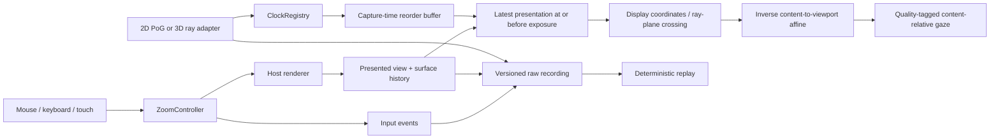

# GazeSync

A standalone framework for recording **where a person looks while they
zoom and pan**. It supports desktop and mobile input, 2D point of gaze (PoG),
3D eye-origin rays, and content-relative reconstruction on a common timeline.
The runnable simulator supplies an idealized, high-accuracy eye signal so the
interaction and synchronization code can be checked independently of a model.

Version 0.2.0 extends the CHI EA 2026 GazeSync system with a standalone JavaScript
core, desktop/mobile adapters, explicit timing and geometry contracts, and a
reproducible simulator. There are **zero runtime dependencies**; [TypeScript
declarations](src/index.d.ts) cover the core, browser and simulation exports.

This is a pre-publication research software draft. Publication remains disabled
(`private: true`, `license: UNLICENSED`) while the maintainer chooses a license.
See the [code audit](docs/AUDIT.md), [release preparation](docs/RELEASE.md), and
[contribution guide](CONTRIBUTING.md). No public repository or package release is
claimed by this draft.

## Run

From this package directory, using Node.js 22 or newer:

```sh
npm test
npm run simulate -- --out artifacts/verification
npm run replay -- artifacts/verification/mobile-session.json
npm start
```

Open [the local interaction lab](http://127.0.0.1:5194/demo/). No install, build,
server account or camera permission is needed. Set `GAZESYNC_PORT` if necessary.
Generated session recordings and numerical summaries belong in ignored
`artifacts/`; the default simulation command only prints the summary.

Select **Desktop** or **Mobile**, play or scrub the scripted scenario, then select
**Try it yourself** for real pointer/keyboard/touch input with synthetic gaze.
The mobile scenario includes pinch-out, pinch-in, a one-finger continuation,
double tap, cancellation, portrait/landscape change and a background gap.
On a touchscreen, use actual two-finger input in hands-on mode. On a desktop,
the mobile replay exercises those same controller methods without touch hardware.
The preview is a scaled **virtual viewport**; its logical coordinates are shown
below the scene. It is not a physical monitor calibration.

## Interaction contract

| Input                                                   | Behavior                                                                                |
| ------------------------------------------------------- | --------------------------------------------------------------------------------------- |
| Desktop mouse wheel / trackpad wheel                    | Exponential zoom at the pointer; pixel, line and page wheel units are accepted.         |
| Left drag                                               | Pan; movement below the drag threshold remains a click/tap.                             |
| Shift + left drag, or Box zoom mode                     | Fit the selected rectangle with aspect ratio preserved; tiny/empty boxes do nothing.    |
| Middle drag                                             | Pan even while Box zoom mode is selected.                                               |
| Ctrl/Cmd + 0, Home, Original button                     | Restore the original fit for the current viewport.                                      |
| Escape                                                  | Cancel an active gesture; otherwise restore the original fit.                           |
| + / −, arrow keys, zoom buttons                         | Keyboard/button zoom and pan with a viewport-center pivot.                              |
| Two touch contacts                                      | Pinch and simultaneous midpoint pan; both contacts determine the content pivot.         |
| Lift one finger during pinch                            | Continue one-finger panning from the current view, without a jump.                      |
| Two short nearby taps                                   | Toggle between original fit and 2.5× fit. Drags, pinches and long presses do not count. |
| Pointer cancellation, lost capture, blur, layout change | Clear the gesture and selection; retain the view already shown.                         |

Zoom is bounded to 1–16× the original fit by default. Content smaller than the
viewport stays centered; larger content is clamped to its edges. Clamping may
prevent exact pivot preservation near an edge. Reset means **fit the entire
content**, rather than one physical content pixel per display pixel.

Gaze is an observation stream. Looking at something does not trigger an action.
The controller deliberately uses the mouse/touch pivot selected by the person.
A future gaze-assisted mode can pass an explicitly confirmed, fresh anchor to
`controller.zoom(factor, t, anchor)`. Such a mode needs its own interaction test.
There is no dwell activation, automatic recalibration from cursor position,
simulated scene depth, or inferred hardware accuracy.

## Architecture



| Module                             | Responsibility                                                            |
| ---------------------------------- | ------------------------------------------------------------------------- |
| [geometry.js](src/geometry.js)     | Pure view operations, affine inversion and metric ray/plane projection.   |
| [controller.js](src/controller.js) | Platform-neutral gesture state machine; no DOM or tracker dependency.     |
| [clocks.js](src/clocks.js)         | Immutable source-clock/epoch conversions with timing uncertainty.         |
| [session.js](src/session.js)       | Presentation history, buffering, quality gates, recording and replay.     |
| [browser.js](src/browser.js)       | Scoped Pointer Events, wheel units, keyboard, focus/capture and disposal. |
| [simulation.js](src/simulation.js) | Seeded desktop/mobile scenarios and known-ground-truth checks.            |

## Minimal integration

```js
import { createView, GazeSession, ZoomController } from 'gazesync'

const session = new GazeSession()
let causes = []
const controller = new ZoomController(
  createView({
    width: 1000,
    height: 600,
    contentWidth: 2000,
    contentHeight: 1200,
  }),
  {
    onInput(event) {
      session.input(event)
      causes.push(event.id)
    },
  },
)

// After drawing each view, record the view that was actually submitted.
// In a browser, use performance.now(); native hosts supply the mapped equivalent.
session.present({
  t: 0,
  contentId: 'image-revision-42',
  view: controller.view,
  surface: { id: 'monitor-1', epoch: 'layout-1' },
  causeIds: causes,
  timing: 'render-callback',
})
causes = []

// Exposure time = 20 ms, inference callback/arrival = 65 ms.
session.gaze(
  {
    id: 'camera-frame-1',
    sourceId: 'webcam-pog',
    type: 'pog2d',
    clockId: 'session',
    clockEpoch: '0',
    timeMs: 20,
    surfaceId: 'monitor-1',
    surfaceEpoch: 'layout-1',
    space: 'normalized-viewport',
    point: { x: 0.6, y: 0.5 },
    valid: true,
    confidence: 0.98,
    calibrationId: 'fit-42',
  },
  65,
)

// Call after supplying every presentation <= now. Default holdback is 60 ms.
const aligned = session.flush(100)
// aligned[0].contentPoint = {x: 1200, y: 600}
```

The imports above use package self-resolution or a bundler. A direct browser module
can import `./src/index.js` instead. For a real canvas, start from [canvas-integration.js](examples/canvas-integration.js),
which includes resize handling, rendering, alignment, source ingestion and cleanup.
Register an external clock on `session.clocks` before pushing its first sample.
The browser adapter attaches listeners only to the target surface and restores
its attributes when disposed. It does not install application routes or change
global browser zoom settings.

Use an axis-aligned, borderless input element; outer CSS rotation, perspective or
padding needs a host-specific coordinate adapter. Content rotation belongs in the
recorded affine. The adapter uses its owning document's clock and lifecycle. If
several documents share a session, the host must convert all their input/render
times to the same session clock. Each retained surface keeps its last known state
even when only another surface continues rendering.

### Connect a native desktop or phone app

The same serializable event contract can be sent from Swift, Kotlin, Flutter or
a desktop SDK to a JavaScript host/service. No native package is installed by
this change. To port the pure core, preserve the contract and run these scenarios
against the port's outputs before adoption.

1. Read the source camera's **exposure timestamp**, confidence, validity and
   calibration identifier. Assign a stable source ID and a per-source sample ID.
2. Convert seconds/ticks into milliseconds explicitly, then register the clock
   mapping. Save the mapping, epoch, uncertainty and any measured drift. A new
   camera boot/reconnection or clock fit gets a new epoch; do not rewrite old fits.
3. Record each view actually rendered, including animated/inertial intermediate
   frames, and the content-to-viewport affine. The built-in controller provides
   pan/zoom; a host can supply its full six-coefficient affine for content rotation,
   arbitrary pivots or existing native gesture/inertia engines.
   Set a stable `contentId` including the image/document revision (default:
   `'content'`). The aligned output retains it so attention from different stimuli
   is distinguishable even when their dimensions and transforms are identical.
4. Tag samples with the surface ID and **layout epoch at exposure**. Bump the epoch
   when the window mapping, display, orientation or tracking reference changes.
   Delayed samples must not acquire the current epoch retroactively.
5. Push samples when received; flush after presentation records are complete
   through the supplied `now`. Consume `contentPoint` only with suitable quality
   flags. Render a live marker only while its capture timestamp is fresh.
6. Record the surface as inactive for app backgrounding or a hidden/occluded
   stimulus. Suspend the source as appropriate. Record missing measurements or
   a gap rather than synthesizing/interpolating across unavailable tracking.

The reusable canvas example handles viewport size changes. A real monitor app
must additionally detect window movement, OS display changes, browser page zoom,
visual viewport/keyboard changes and DPR changes whenever these affect its chosen
coordinate mapping. Feed those changes through a new surface epoch. Browser
geometry alone does not establish a measured physical screen pose.

### Clock and presentation semantics

All canonical times are monotonic **milliseconds in one session clock**.
`performance.now()` is suitable within one browser execution context. Cross-device
wall clocks and callback arrival times are not exposure timestamps.

```js
session.clocks.register({
  id: 'phone-camera',
  epoch: 'boot-3',
  sourceOriginMs: 620000,
  sessionOriginMs: 1500,
  rate: 1.00012,
  uncertaintyMs: 2,
  driftUncertaintyPpm: 10,
})
// tSession = sessionOriginMs + (tSource - sourceOriginMs) * rate
```

The mapping must come from host/SDK clock information or a measured clock-sync
procedure; network round trips can only bound offset, not prove one-way delay.
The framework does not estimate a clock fit from gaze/cursor coincidence.
Uncertainty includes the configured bound, accumulated drift uncertainty and
floating-point conversion error. Samples whose uncertainty interval crosses a
visual change receive `ambiguous-presentation`; large uncertainty receives
`clock-uncertain`. An unfinished uncertainty interval at final flush is flagged
`incomplete-uncertainty-window`. Each surface has its own indexed presentation history. Give controllers distinct
`inputPrefix` values when they share a session. A view at time `t` applies inclusively from `t` until the next
presentation. Ties between presentations use the last submitted state.

`flush(now)` declares that **all presentation records through now are submitted**.
Later presentation insertion at or before that watermark is rejected. Input
commands may precede rendering and multiple commands may share one frame; their
IDs remain separate in `causeIds`. The join uses presentation history, not the
nearest command, and does not interpolate discrete transforms across zoom/reset.

Browser rendering timestamps are callback estimates, not measured photon onset.
Native display feedback can use `timing: 'display-feedback'`; the simulator uses
`'synthetic'`. Real latency validation needs camera/display timing measurements.

### Coordinates and 3D

- Viewport origin is top left, +x right, +y down. Units are logical viewport pixels
  (browser CSS pixels or native points). Canvas backing pixels/DPR are a rendering
  concern and must not scale gaze twice. Content units are intrinsic image pixels.
- `space: 'viewport'` supplies logical viewport points. `normalized-viewport`
  supplies dimensionless viewport coordinates. Values outside [0,1] are retained.
- `normalized-display` supplies full-display coordinates. Every affected frame
  must contain `surface.display = {width, height, left, top}` in one consistent
  logical unit, where `left/top` locate the viewport on that display. Adapters
  convert SDK physical pixels to those units using measured display geometry.
- A frame's `matrix` is `[a,b,c,d,e,f]`, with `x'=a*x+c*y+e`, `y'=b*x+d*y+f`.
  It maps intrinsic content directly into the local viewport, including fit,
  letterboxing, translation, rotation and pivot. Singular matrices are rejected.
- `type: 'ray3d'` supplies `ray = {origin:[x,y,z], direction:[x,y,z], frameId}`.
  Origin and display-plane dimensions use **meters**; direction need not be unit
  length. The adapter transforms head/camera rays to the plane's frame at exposure.
  There is no implicit mirroring, axis flip, camera extrinsic or 2D-to-3D inference.
- A plane supplies `topLeft`, orthonormal `right/down`, `widthMeters`,
  `heightMeters` and matching `frameId`. Use `static:true` only for a stationary,
  registered plane. Moving phones need per-frame measured geometry and
  `surface.poseTimeMs` in session time. Stale/future poses are flagged.
- `rayHit` is a **display-plane crossing** and ray distance to that crossing. It
  is not a scene fixation or depth estimate. Raw rays remain in the recording for
  external 3D scene/depth processing. Two independent eyes can use separate source
  IDs; no unrequested binocular averaging/fusion is performed.

For example, attach a measured plane to a frame:

```js
const plane = {
  frameId: 'world-session-8',
  topLeft: [-0.265, 0.165, 0],
  right: [1, 0, 0],
  down: [0, -1, 0],
  widthMeters: 0.53,
  heightMeters: 0.33,
  static: true,
}
// A 3D sample uses type:'ray3d' and ray:{origin,direction,frameId:plane.frameId}.
// Frame surface: {id:'monitor-1', epoch:'layout-1', plane}.
```

## Quality, persistence and replay

All source records are retained in a bounded recording; quality failures are
annotated rather than silently deleted. Invalid/blink samples may omit their
point/ray. Every aligned record includes capture/receive/alignment timestamps,
clock uncertainty, presentation ID/timing/cause IDs, content/viewport coordinates,
optional 3D hit, flags and `usable`.

Quality flags cover blink, invalid/low-confidence measurements, future capture,
uncertain/ambiguous clocks, wrong surface/epoch/frame, missing history/geometry,
stale/future plane poses, inactive surfaces and offscreen/off-content points.
Coordinates outside the display are never clipped into valid attention samples.
`late-arrival` and `high-latency` are informational for offline reconstruction;
live consumers must additionally enforce their own capture-age limit. Never
keep showing a pre-blink valid dot after a newer invalid measurement arrives.

Default bounds: 7,200 presentation frames, 100,000 raw records/aligned samples,
4,096 pending samples, 60 ms reorder holdback, 8 ms clock uncertainty gate,
50 ms dynamic-pose age, confidence 0.6 and 250 ms high-latency annotation.
These are configurable engineering defaults, not scientific acceptance thresholds.
Late samples can still map against retained history. Older samples receive
`missing-history`; a full pending buffer throws so the host can apply backpressure.

```js
import { replay } from 'gazesync'
const recording = session.export() // JSON-serializable schemaVersion:'1.1', implementationVersion:'0.2.0'
const restored = replay(JSON.parse(JSON.stringify(recording)))
// restored.aligned reproduces the original alignment decisions exactly.
```

The recorder reports `recordsDropped`, `alignedDropped` and `pendingCount`.
Replay checks schema/implementation versions, total record count and consecutive
record sequences, and refuses a truncated raw recording. Version 0.1.0 recordings
require their original implementation; they are never silently reinterpreted. Long sessions need a host persistence
sink that saves raw chunks before rollover, or a deliberately larger budget;
the in-memory recorder is not a background database. Flush with `{final:true}`
after the final presentation and pending source deliveries to finish a session.
An export taken during capture can contain pending samples, which remain explicit.
Session clocks/configurations must travel with the recording. Keep real participant
traces outside Git; the demo exports synthetic data only.

## Simulation and verification

Both scenarios execute the same `ZoomController` and `GazeSession` that developers
import. Synthetic gaze includes content landmarks across scales, screen-fixed
pan attention, context scanning on zoom-out, fixation/saccade reading steps,
small drift, Gaussian noise, blinks, low confidence and independent delivery jitter.
Touch positions and mouse positions remain distinct from gaze. Pinch movement
uses a smooth ballistic-shaped profile and a moving midpoint.
The mobile fixture also varies the metric display plane with small translations,
yaw and roll, recording its pose time on every frame. Geometry is held between
those frames; this does not establish sub-frame pose accuracy on a physical phone.

The defaults assume 120 Hz gaze, 60 Hz display, 0.45 logical-pixel noise SD per
axis, 28–63 ms ordinary delivery delay, occasional extra 170 ms delay and a
known affine tracker-clock drift. Device/sensor clocks have separate phases.
These parameters are **illustrative test assumptions**, not estimates fitted to
people or claims about a deployed estimator. The 2D/ray fixtures are paired
from the same noisy display target to isolate projection consistency.

Tests cover capture-vs-arrival reconstruction, exact event boundaries, uncertain
clock intervals, random rotated/mirrored affine inversion, missing/reverse/parallel
rays, moving-pose gates, window offsets, epochs, blinks, source duplicates, bounded
buffers, wheel units, marquee cancellation, double taps and pinch-to-pan transitions.
Desktop and mobile scenarios run at three random seeds and reconstruct raw replay.
The CLI exits nonzero on empty/unmapped results, frame mismatch, reconstruction error, replay mismatch,
unfinished pending samples or failed final reset. Its summary also shows the error
from a deliberately incorrect arrival-time baseline.

Manual browser checks: play and scrub each device scenario; verify mobile rotation
and background gap; enter hands-on mode and try wheel/box/pan/reset, touch pinch
and double tap, cancellation, signal selection and JSON export. Automated tests
cannot establish physical gaze accuracy, finger comfort or browser/OS behavior on
unmeasured hardware.

## Research and design decisions

- [GazeSync, CHI EA 2026](https://arxiv.org/html/2604.15348v1), the original paper ([ACM DOI](https://doi.org/10.1145/3772363.3798725)), motivates synchronized
  UI-state logging and inverse content reconstruction. Its small formative study
  reports drift and compound-transform failures. This implementation adds explicit
  capture/presentation/arrival times, clock uncertainty, 3D geometry and replay gates;
  it does not claim to reproduce that study or copy its software.
- [Wenclik & Touya, 2026](https://www.tandfonline.com/doi/full/10.1080/15230406.2026.2650276)
  report map-viewing archetypes: cursor-focused zoom-in, context around the pointer
  during zoom-out, and screen-fixed attention during pan. The simulator exercises
  these separately, plus content-landmark attention. Their observations do not imply
  one universal behavior or establish mobile timing parameters.
- [Stellmach & Dachselt, ETRA 2012](https://imld.de/cnt/uploads/2013/07/2012-ETRA-GazeSuppPanAndZoom.pdf)
  examine gaze with wheel/touch/tilt input and discuss unintended activation.
  This framework keeps observation independent of control and exposes an explicit
  anchor API for a future, intentionally activated gaze-assisted experiment.
- [Pointer Events](https://www.w3.org/TR/pointerevents3/),
  [High Resolution Time](https://www.w3.org/TR/hr-time-3/) and
  [UI Events](https://www.w3.org/TR/uievents/) inform the browser adapter's capture,
  cancellation, monotonic clock and wheel-unit handling.

**Next integration step:** connect one real desktop estimator and one native phone
capture adapter; measure clock/display timing and held-out spatial error through
the same recorded scenarios. Keep calibration and model evaluation separate from software verification. Porting the adapter or core into the shipped apps is separate work.
