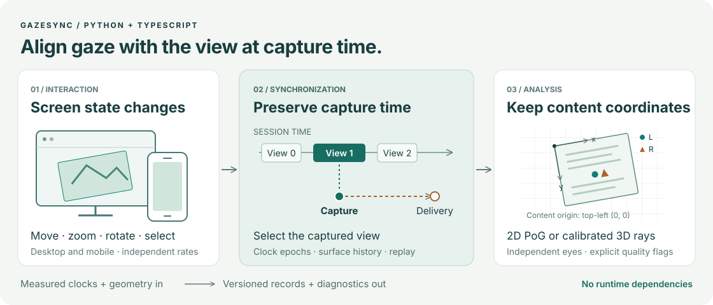
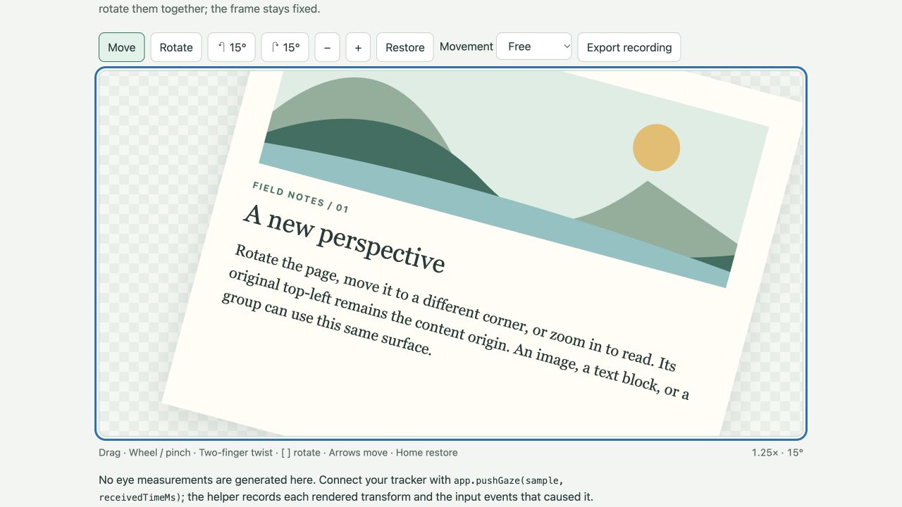

# GazeSync

Synchronize eye-tracking measurements with the screen state a person was viewing
while moving, zooming, rotating or selecting content. The Python and TypeScript packages
share a versioned recording contract and reproducible conformance tests.

**Development release 0.5.2 · schema 2.1 · GPL-3.0-only.** The source repository is
public. The [Python test release](https://test.pypi.org/project/gazesync/0.5.2/)
has passed TestPyPI installation checks; production PyPI and npm releases are pending.



Start with the [browser surface](docs/INTERACTION.md),
[Python quick start](https://github.com/GazeLei/GazeSync/blob/main/python/README.md),
or [tracker adapter guide](docs/ADAPTERS.md).

## What is implemented

- Desktop wheel zoom at the pointer, drag to pan, Shift-drag to zoom a box,
  keyboard move/rotate/zoom/reset/cancel; mobile pinch and twist with a moving midpoint, pan,
  pinch-to-pan transitions, double tap and contact cancellation.
- Arbitrary positive viewport dimensions, logical pixels and explicit device
  pixel ratio; independent input, presentation and gaze cadences. No 60 Hz or
  equal-eye-rate assumption. Built-in anchored rotation, combined touch transforms,
  and free or bounded content movement.
- 2D PoG, 3D eye-origin rays and retained direction-only measurements; independent
  left/right, monocular, explicitly combined and unknown-eye records.
- Source-clock conversion with immutable epochs, presentation history per
  surface, bounded reordering, quality flags, structured diagnostics and replay.
- Generic model, Tobii Pro dictionary, EyeLink/PyLink bridge and Pupil Core
  normalizers. **These adapters are fixture-tested; physical devices have not
  been validated with this release.** Hardware SDKs and inference models are not
  bundled. Measured calibration and timing remain host responsibilities.

## Install a development build

For the Python test distribution, use the separate TestPyPI index:

```sh
python -m pip install --index-url https://test.pypi.org/simple/ --no-deps gazesync==0.5.2
```

Production registry releases are pending. Verified local artifacts can also be
installed directly:

```sh
python -m pip install /absolute/path/to/gazesync-0.5.2-py3-none-any.whl
npm install /absolute/path/to/gazesync-0.5.2.tgz
```

For a source checkout, follow the next section. After the first public uploads,
the registry commands will be `pip install gazesync` and `npm install gazesync`.

The package is ESM and includes compiled JavaScript and TypeScript declarations.
Node consumers use `import` in an `.mjs` file or a project with `"type": "module"`.
CommonJS callers can use `await import('gazesync')` inside an async function. Static
`require('gazesync')` is not a supported entry point. TypeScript projects should
use `moduleResolution: "NodeNext"` or `"Bundler"`; browser code also needs the DOM
library. Core/model/simulation types can be used without DOM declarations.
The package ships `docs/` integration guides and copyable `examples/`. Repository
commands such as `npm start`, `npm test`, and figure generation belong to a source
checkout; the installed library needs no build step or install-time script.

## Start from source

Requires Node.js 22+ for development and Python 3.10+. The browser bundle uses
standard ES modules; Python has no runtime dependencies.

```sh
npm ci --ignore-scripts
npm test
npm run test:types
npm start                    # http://127.0.0.1:5194/demo/
python3 -m venv .venv
.venv/bin/python -m pip install -e './python[test]'
.venv/bin/python -m pytest python/tests
npm run test:conformance      # 78 baseline + 8 content-motion configurations
```

The interaction lab includes deterministic desktop/mobile replay and a manual
canvas. The full frequency/size/eye matrix runs through the CLI. Use
`GAZESYNC_PORT=5195 npm start` if the default port is occupied.

## Move an image or text page in the browser

The [content surface example](examples/content-surface.html) is runnable after
`npm start`. It works with ordinary HTML text, images, SVG and grouped content.



*The included browser example. It records content transforms; connect a tracker
to supply eye measurements.*

```ts
import { createGazeSurface } from 'gazesync/browser'
const app = createGazeSurface(frameElement, contentElement, {
  contentWidth: 720, contentHeight: 600, contentId: 'page-01',
  panBounds: 'none', // move freely, including at the original fit scale
})
app.controller.rotate(Math.PI / 12, performance.now())
app.controller.move(40, 20, performance.now())
// At exposure: retain app.captureContext with your tracker/camera frame.
// At delivery: app.pushGaze(normalizedSampleWithCaptureContext, performance.now())
```

The helper records rendered transforms and input, handles resize and lifecycle,
and offers `dispose()` for teardown. Drag to move, use two fingers to pinch and
twist, press `[` / `]` to rotate, and Home to restore. Frame padding must be zero;
content dimensions define a stable intrinsic coordinate system.
See [interaction and gaze setup](docs/INTERACTION.md) for a complete integration,
Python equivalents, bounds, clipping and 3D geometry.

## TypeScript integration

```ts
import { GazeSession, createView } from 'gazesync'

const session = new GazeSession({}, {
  onDiagnostic: d => console.warn(d.code, d.message, d.remedy),
})
session.registerSource({
  id: 'my-model', kind: 'model', adapter: 'my-adapter-v1',
  eyes: ['left', 'right'], trackingMode: 'binocular-independent',
  eyeRatesHz: { left: 120, right: 60 }, timestampKind: 'exposure',
})
session.present({
  t: 0, view: createView({ width: 1000, height: 600,
                         contentWidth: 2000, contentHeight: 1200 }),
  surface: { id: 'screen', epoch: '1' }, timing: 'render-callback',
})
session.gaze({
  id: 'capture-1', sourceId: 'my-model', eye: 'left',
  clockId: 'session', clockEpoch: '0', timeMs: 20,
  surfaceId: 'screen', surfaceEpoch: '1',
  type: 'pog2d', space: 'normalized-viewport', point: { x: .5, y: .5 },
  valid: true, confidence: .95,
}, 40) // receipt time; it does not replace capture time
const rows = session.flush(100)
```

These are illustrative session-clock times. For a real source, register a measured
clock mapping and preserve the original capture timestamp. `flush(100)` promises
that every presentation through time 100 has already been submitted. Register
frames before advancing that watermark. A render callback is an estimate of
presentation, not measured light emission. See [the protocol](docs/PROTOCOL.md).

For Python, the equivalent API is `GazeSession`, `create_view`,
`register_source`, `present(t=..., view=..., surface=...)`, `gaze(sample, receipt)`
and `flush(time)`. See [the Python quick start](https://github.com/GazeLei/GazeSync/blob/main/python/README.md).

Attach browser input with `attachBrowserControls` from `gazesync/browser`; the
[canvas integration](examples/canvas-integration.js) shows resize, hidden-tab
boundaries, render snapshots and teardown. Native Python hosts can feed
`InteractionController` (also named `ZoomController`) from their GUI callbacks and record the resulting display state.
The library does not hook the OS or record unrelated applications.

## Camera and screen geometry

Use [the coordinate-frame guide](docs/COORDINATES.md) to distinguish camera, eye,
active display, viewport and content origins. It includes measured-extrinsic
conversion, named rigid-transform helpers and the full-display/cropped-viewport
contract. Ray hits retain their metric frame ID. Version 0.5.2 uses schema 2.1;
older recordings require their original implementation.

## Adapt a source and investigate warnings

Use [the adapter guide](docs/ADAPTERS.md) for timestamps, units, eye conventions,
SDK bridges and models. Register `adapter.source` before the first sample;
ingest each normalized sample separately and retain adapter warnings. The
[diagnostics guide](docs/DIAGNOSTICS.md) explains first-occurrence callbacks,
aggregated counts, rate estimates and corrective actions.

`pairEyes` / `pair_eyes` is an optional offline, chronological, one-to-one pairing
operation with a maximum skew. It never averages eyes or silently substitutes a
combined measurement. Streams with different clock identities, epochs or
calibrations or content identities remain separate. Direction-only data stay available for downstream
analysis but cannot be projected without a measured eye origin.

## Reproduce the evidence

```sh
npm run simulate -- --out artifacts/scenarios
npm run test:conformance
npm run test:retention
.venv/bin/python -m gazesync simulate --width 390 --height 844 \
  --display-hz 120 --input-hz 1000 --gaze-hz 600 --right-gaze-hz 120 \
  --mode binocular-independent
npm run release:check
npm run bench
```

The recorded validation covers 78 configurations and 107,070 observations,
including 30–240 Hz displays and 30–2,000 Hz gaze. All capture-frame selections
match the synthetic reference. This measures software consistency, not human
behavioral validity or hardware accuracy. Configuration, result data and figure
sources are included in [the implementation paper](https://github.com/GazeLei/GazeSync/blob/main/paper/README.md).

## Citation, licensing and release

Please cite both papers when using this framework. The original paper describes
the mobile GazeSync system; the implementation report describes this package,
its geometry and its verification.

**Original GazeSync paper**

```bibtex
@inproceedings{lei2026gazesync,
  title = {{GazeSync}: A Mobile Eye-Tracking Tool for Analyzing Visual Attention on Dynamically Manipulated Content},
  author = {Lei, Yaxiong and Talwar, Rishab and He, Shijing and Gong, Xinya and Wang, Yuheng and Cai, Xudong and Guo, Zhongliang and Ye, Juan},
  booktitle = {Proceedings of the Extended Abstracts of the 2026 CHI Conference on Human Factors in Computing Systems},
  pages = {1--7},
  year = {2026},
  doi = {10.1145/3772363.3798725}
}
```

**Implementation report**

```bibtex
@misc{gazesync2026implementation,
  title = {{GazeSync}: Reproducible Synchronization of Screen Interaction and Multi-Source Eye Tracking},
  author = {Lei, Yaxiong and He, Shijing and Gong, Xinya and Ye, Juan},
  year = {2026},
  howpublished = {Technical report, version 0.5.2},
  url = {https://github.com/GazeLei/GazeSync/tree/main/paper},
  note = {Technical report; arXiv submission pending. Update with the preprint identifier after submission.}
}
```

The implementation preprint's arXiv identifier is pending; the report entry uses
the repository URL. It can be added after software release. Both entries are
also maintained in [CITATION.bib](CITATION.bib).

The code is **GPL-3.0-only**. [LICENSE](LICENSE) contains the terms;
[NOTICE](NOTICE) distinguishes manuscript rights and separately licensed SDKs.
Citation is a scholarly request, not an additional software-license restriction.
See [release preparation](https://github.com/GazeLei/GazeSync/blob/main/docs/RELEASE.md) for npm/PyPI artifacts, trusted
publishing, the initial npm bootstrap and the disabled publication gates.

This is a standalone repository with no imports, datasets, checkpoints or Git
history from the private parent project. Contributions start with
[CONTRIBUTING.md](https://github.com/GazeLei/GazeSync/blob/main/CONTRIBUTING.md); the audit record is in [docs/AUDIT.md](https://github.com/GazeLei/GazeSync/blob/main/docs/AUDIT.md).
